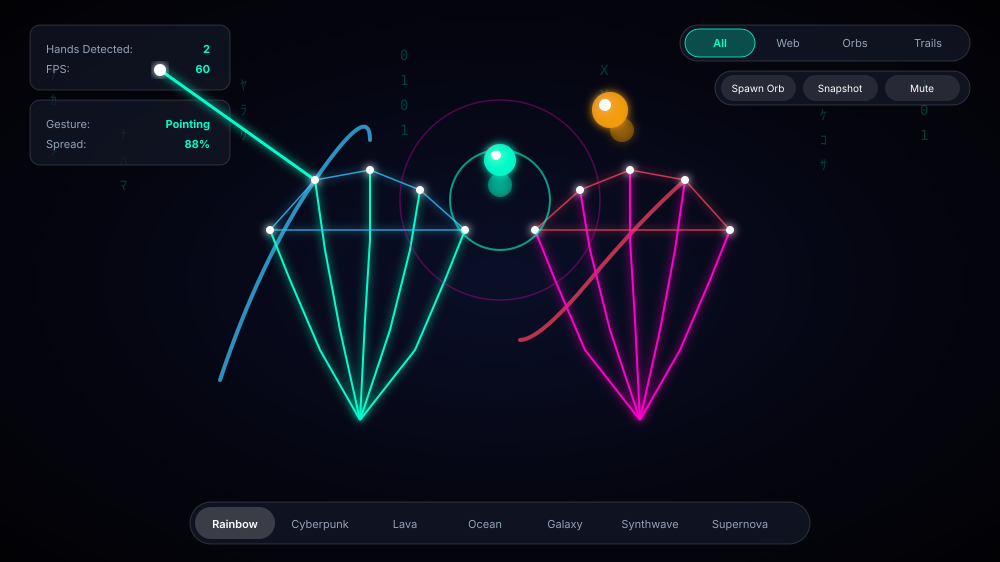
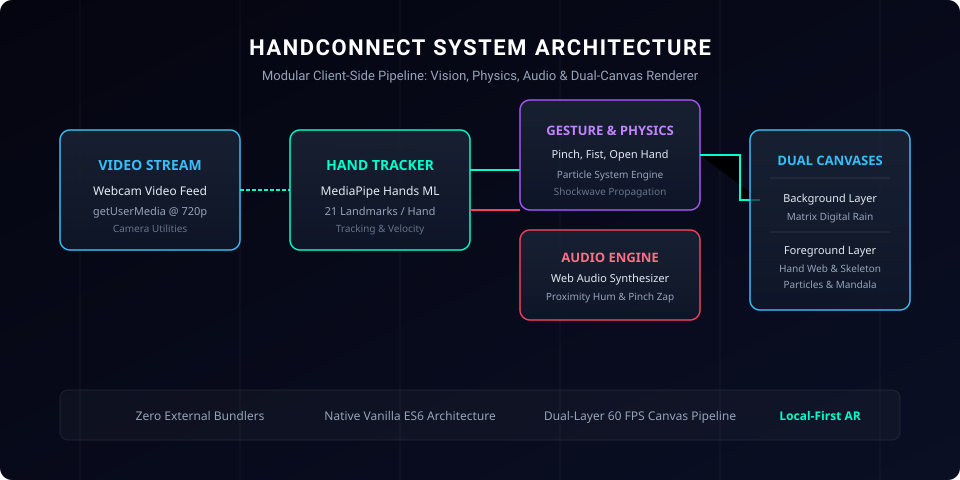

# HandConnect

A browser-based augmented reality hand tracking interface and procedural audiovisual system powered by MediaPipe and the Web Audio API.

[](LICENSE)
[](#prerequisites)
[](https://mediapipe.dev/)
[](#technology-stack)
[](#testing)

HandConnect delivers zero-dependency, real-time hand skeleton tracking and geometric visualization directly in the browser. Using a local webcam feed, the system tracks 21 distinct 3D landmarks per hand at 60 FPS, synthesizing dynamic procedural audio, particle physics, and interactive holographic geometry.

---

## Preview



---

## Features

- Real-Time Multi-Hand Tracking: Tracks up to two hands simultaneously with 21 coordinates per hand using MediaPipe Hands ML.
- Geometric Fingertip Web: Generates an interconnected string lattice between all active fingertips when the hand is open.
- Cross-Hand Coordinate Linking: Draws synchronized geometric links between matching finger nodes across dual hands with automated mandala rotation.
- Real-Time Gesture Recognition: Computes hand spread percentages and detects discrete states (Open Hand, Fist, Pinch) with zero latency.
- Dynamic Shockwave and Particle Physics: Spawns momentum-based particle emitters and expanding radial shockwaves on pinch triggers.
- Velocity-Modulated Matrix Rain: Dual-canvas matrix rain background that reacts in real-time to hand movement speed.
- Procedural Audio Engine: Modulates a proximity-based continuous hum oscillator between hands and triggers synthetic frequency-ramped zap effects on pinch.
- Five Theme Presets: Dynamic color themes including Rainbow, Cyberpunk, Lava, Ocean, and Galaxy.
- Performance Architecture: Separation of background and foreground canvases, throttled text metrics rendering, smoothed velocity filters, and capped memory buffers.

---

## System Architecture



The application follows a modular pipeline designed for client-side execution without requiring compilation or bundling steps:

1. Video Stream Layer: Captures the camera input using `navigator.mediaDevices.getUserMedia` via MediaPipe Camera utilities.
2. Machine Learning Inference: MediaPipe Hands ML extracts 21 landmark vectors per detected hand.
3. Gesture & Coordinate Processor (`js/gestures.js`): Maps normalized screen coordinates to canvas space, computes Euclidean distances, and classifies gestures.
4. Audio Synthesis Engine (`js/audio.js`): Web Audio API oscillators modulate frequency and gain based on inter-hand proximity and gesture triggers.
5. Particle & Shockwave Simulator (`js/particles.js`): Manages physics updates, lifecycles, and ring shockwave propagation.
6. Dual-Layer Canvas Renderer:
   - Background Canvas (`js/matrix.js`): Renders Katakana digital rain with alpha-fading trail effects.
   - Foreground Canvas (`js/app.js`): Draws bone segments, fingertip nodes, inter-finger string webs, cross-hand mandalas, and particles.

---

## Technology Stack

| Component | Technology | Description |
| :--- | :--- | :--- |
| Hand Landmark Detection | MediaPipe Hands | Google client-side ML pipeline for hand landmark detection |
| Camera Stream Pipeline | MediaPipe Camera Utils | Frame acquisition and synchronization loop |
| Audio Synthesis | Web Audio API | Low-latency audio synthesis using native oscillators and gain nodes |
| Visual Rendering | HTML5 Canvas 2D API | Dual-buffered 2D canvas pipeline with destination-out blending |
| Core Language | Vanilla JavaScript (ES6+) | Dependency-free modular architecture |
| Styling & UI | CSS3 Glassmorphism | Hardware-accelerated frosted glass HUD with CSS custom properties |
| Unit Testing | Node.js Test Runner | Native test runner (`node --test`) with zero third-party dependencies |

---

## Project Structure

```text
HandConnect/
├── assets/
│   ├── architecture.svg       # Vector diagram of system architecture
│   └── preview.svg            # Vector preview of tracking and HUD
├── css/
│   └── style.css              # Application layout, HUD, and glassmorphism styling
├── js/
│   ├── app.js                 # Main application controller and render loop
│   ├── audio.js               # Procedural audio synthesis engine
│   ├── gestures.js            # Gesture recognition, bone calculation, and coordinate mapping
│   ├── matrix.js              # Background matrix rain canvas generator
│   ├── particles.js           # Particle emitters and radial shockwave simulator
│   └── tracker.js             # MediaPipe camera wrapper and error handler
├── tests/
│   └── gestures.test.js       # Unit tests for geometry, gestures, and physics
├── index.html                 # Semantic entry point
├── LICENSE                    # MIT License
├── package.json               # Project metadata and test scripts
└── README.md                  # Project documentation
```

---

## Prerequisites

- Modern web browser with WebRTC and Web Audio support:
  - Google Chrome 80+
  - Microsoft Edge 80+
  - Mozilla Firefox 75+
  - Apple Safari 14+
- Built-in or external USB webcam.
- Camera access permissions enabled in the browser.

---

## Installation and Execution

HandConnect requires no package installations or build steps to run. However, browsers require a secure origin (HTTPS or `http://localhost`) to grant webcam access.

### Option 1: Local HTTP Server (Recommended)

Using Node.js:
```bash
# Clone the repository
git clone https://github.com/Mrvikas06/HandConnect.git
cd HandConnect

# Start local server
npm start
# Alternatively: npx serve . -l 3000
```
Open `http://localhost:3000` in your browser.

Using Python:
```bash
# Python 3
python -m http.server 8000
```
Open `http://localhost:8000` in your browser.

### Option 2: Live GitHub Pages

The application is deployed directly to GitHub Pages at:
[https://mrvikas06.github.io/HandConnect/](https://mrvikas06.github.io/HandConnect/)

---

## Configuration and Theme Settings

Themes are selectable from the bottom navigation bar or programmatically through `app.currentTheme`. Each theme defines mathematical color gradients over time and landmark indices:

| Theme Name | Description | Color Generation Strategy |
| :--- | :--- | :--- |
| Rainbow | Spectrum cycle | `hsl((t * 100 + index * (360 / total)) % 360, 100%, 60%)` |
| Cyberpunk | Dual contrast | Alternating `#ff003c` (Crimson) and `#00f0ff` (Cyan) |
| Lava | Thermal pulse | Warm hue band (10 deg to 40 deg) with sine-modulated lightness |
| Ocean | Oceanic cool | Cyan and blue spectrum (180 deg to 280 deg) |
| Galaxy | Deep ultraviolet | Violet base (260 deg) with harmonic oscillation |

---

## Gestures Guide

| Gesture | Trigger Criteria | Visual & Audio Response |
| :--- | :--- | :--- |
| Open Hand | Distance between index and pinky tip > 0.17 | Fingertip string lattice connecting all five fingers |
| Fist | Distance between index and pinky tip < 0.17 | Skeleton connectors remain visible, string lattice collapses |
| Pinch | Distance between thumb and index tip < 0.05 | Radial shockwave emitted, 800 Hz to 40 Hz sawtooth zap triggered |
| Dual Hands | Two hands simultaneously detected | Cross-hand link strands and rotating geometric mandala |
| Fast Movement | Smoothed velocity vector > 0.05 | Matrix rain columns accelerate proportionally |

---

## Testing

The project includes unit tests covering coordinate mapping, gesture thresholds, particle lifecycle pruning, and theme generators.

Execute the test suite using Node.js:

```bash
npm test
```

Sample output:
```text
✔ Geometry: getDist calculates Euclidean distance correctly
✔ Geometry: mapToCanvas scales normalized coordinates to dimensions
✔ Gestures: FINGER_TIPS and HAND_CONNECTIONS are defined and valid
✔ GestureDetector: detects empty hands correctly
✔ GestureDetector: detects open hand and fist based on spread
✔ GestureDetector: detects pinch and midpoint
✔ ParticleSystem: manages particle and shockwave capacity and lifecycle
✔ Themes: all themes return valid color definitions
ℹ tests 8
ℹ pass 8
ℹ fail 0
```

---

## License

This project is licensed under the MIT License. See the [LICENSE](LICENSE) file for complete terms.
